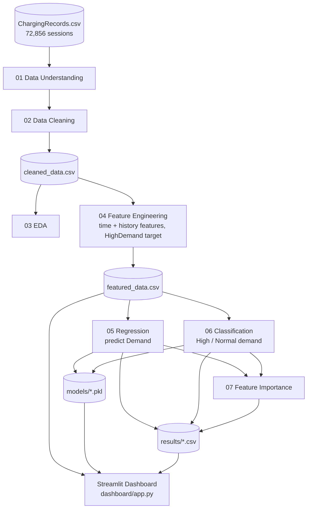

# EV Charging Demand Prediction and Usage Pattern Analysis
 
(Domain: Electric Vehicles and Sustainable Transportation).
 
An end-to-end machine learning project that analyzes EV charging station usage and predicts charging demand. It covers data cleaning, EDA, feature engineering, regression, classification, feature importance and an interactive Streamlit dashboard.
 
---
 
## Table of Contents
 
1. [Problem Statement](#1-problem-statement)
2. [Business Use Cases](#2-business-use-cases)
3. [Dataset](#3-dataset)
4. [Project Structure](#4-project-structure)
5. [Architecture & Workflow](#5-architecture--workflow)
6. [Step-by-Step Methodology](#6-step-by-step-methodology)
7. [Results](#7-results)
8. [Key Findings](#8-key-findings)
9. [Streamlit Dashboard](#9-streamlit-dashboard)
10. [Setup and Installation](#10-setup-and-installation)
11. [How to Run](#11-how-to-run)
12. [Saved Files](#12-saved-files)
13. [Limitations](#13-limitations)
14. [Future Improvements](#14-future-improvements)
15. [Tech Stack](#15-tech-stack)
16. [Author](#16-author)
17. [License](#17-license)
---
 
## 1. Problem Statement
 
Develop a machine learning system to analyze EV charging station usage patterns and predict charging demand based on charger type, location, charging company, time of charging and historical usage behavior.
 
The project has two machine learning problems:
 
| # | Problem | Type | Target |
|---|---|---|---|
| 1 | Charging Demand Prediction | Regression | `Demand` |
| 2 | High-Demand Session Prediction | Classification | `HighDemand` (Demand >= median) |
 
The final output is a Streamlit dashboard that combines the usage analysis, model comparison, feature importance and a live demand prediction tool.
 
## 2. Business Use Cases
 
- **Demand prediction:** anticipate busy and low-demand sessions.
- **Station planning:** find locations and time periods with consistently high demand.
- **Capacity planning:** plan charger availability based on expected demand.
- **Peak demand management:** identify high-demand periods and reduce congestion.
- **Charger utilization analysis:** compare chargers, locations and companies, and find underused infrastructure.
- **Operational optimization:** improve staffing and maintenance scheduling.
- **Customer experience:** reduce waiting times during peak periods.
## 3. Dataset
 
- **File:** `ChargingRecords.csv`
- **Source:** publicly available EV charging transaction dataset
- **Size:** 72,856 charging sessions, 13 columns
- **Period:** 30 Sep 2021 to 30 Sep 2022 (366 days)
### Original columns
 
| Column | Description |
|---|---|
| `UserID` | Identifier of the user who charged |
| `ChargerID` | Identifier of the charger used |
| `ChargerCompany` | Company operating the charger (coded as a number, treated as a category) |
| `Location` | Type of place where the charger is installed (for example resort, camping, public area) |
| `ChargerType` | Type of charger (coded as a number, treated as a category) |
| `StartDay`, `StartTime` | Date and time charging started |
| `EndDay`, `EndTime` | Date and time charging ended |
| `StartDatetime`, `EndDatetime` | Start and end combined into one timestamp |
| `Duration` | Length of the charging session |
| `Demand` | Charging demand of the session (regression target) |
 
### Engineered columns
 
| Column | Description |
|---|---|
| `Hour`, `Day`, `Month`, `DayOfWeek` | Parts of the start time (`DayOfWeek`: 0 = Monday) |
| `IsWeekend` | 1 if the session started on Saturday or Sunday |
| `TimeOfDay` | Morning (5-12), Afternoon (12-17), Evening (17-21), Night (21-5) |
| `User_PrevSessions` | Number of earlier sessions by the same user |
| `User_AvgPastDemand` | The user's average demand over earlier sessions only |
| `Charger_PrevSessions` | Number of earlier sessions on the same charger |
| `Charger_AvgPastDemand` | The charger's average demand over earlier sessions only |
| `IsNewUser` | 1 if this is the user's first session |
| `HighDemand` | 1 if `Demand` >= median demand (14.1), else 0 (classification target) |
 
## 4. Project Structure
 
```
EV_Charging_Demand_Analysis/
├── data/
│   ├── raw/
│   │   └── ChargingRecords.csv
│   └── processed/
│       ├── cleaned_data.csv
│       └── featured_data.csv
├── notebooks/
│   ├── 01_data_understanding_cleaning.ipynb
│   ├── 02_data_cleaning.ipynb
│   ├── 03_eda.ipynb
│   ├── 04_feature_engineering.ipynb
│   ├── 05_regression.ipynb
│   ├── 06_classification.ipynb
│   └── 07_explainability.ipynb
├── models/
│   ├── best_regression_model.pkl
│   └── best_classification_model.pkl
├── results/
│   ├── regression_results.csv
│   ├── classification_results.csv
│   ├── reg_feature_importance.csv
│   └── clf_feature_importance.csv
├── dashboard/
│   └── app.py
├── requirements.txt
├── .gitignore
├── LICENSE
└── README.md
```
 
## 5.  Architecture & Workflow
 
### Workflow
 
```
Data Understanding -> Data Cleaning -> EDA -> Feature Engineering
-> Regression -> Classification -> Feature Importance -> Streamlit Dashboard
```
 
### Architecture
 

 
| Layer | Components | Output |
|---|---|---|
| **Data** | Raw CSV, cleaning, feature engineering | `cleaned_data.csv`, `featured_data.csv` |
| **Modeling** | Regression, Classification | `models/*.pkl`, metric tables |
| **Feature importance** | LightGBM and Random Forest importance | Importance CSVs |
| **Application** | Streamlit dashboard | Interactive pages for usage analysis, model comparison and live demand prediction |
 
## 6. Step-by-Step Methodology
 
### 6.1 Data Understanding (`01_data_understanding_cleaning.ipynb`)
- Loaded the CSV and checked shape, columns, data types, summary statistics and unique values.
- Reviewed the first rows to understand what one record represents (one charging session).
### 6.2 Data Cleaning (`02_data_cleaning.ipynb`)
- Converted `StartDatetime`, `EndDatetime`, `StartDay`, `EndDay` to datetime.
- Converted `UserID`, `ChargerID`, `ChargerCompany`, `ChargerType` to categories (they are identifiers, not quantities).
- Checked missing values and removed duplicate rows.
- Checked correctness: end time before start time, `Demand <= 0`, `Duration <= 0`, and whether `Duration` matches the timestamps.
- Detected outliers with the IQR method. Outliers were **kept** because large sessions are real charging events. Only impossible values are treated as errors.
- Saved `data/processed/cleaned_data.csv`.
### 6.3 Exploratory Data Analysis (`03_eda.ipynb`)
- Univariate: histograms, box plots and skewness of `Demand` and `Duration`.
- Categorical: counts by charger type, company and location.
- Bivariate: average demand by charger type, company, location, hour, day of week and month.
- Correlation heatmap of numeric columns.
- Daily demand trend over the full period.
### 6.4 Feature Engineering (`04_feature_engineering.ipynb`)
- Time features: hour, day, month, day of week, weekend flag, time of day.
- History features: user and charger previous session count and past average demand.
- **Leakage control:** history features use `shift(1)` before the expanding mean, so a session's own `Demand` is never used in its own features. First-time users and chargers get 0.
- Classification target: `HighDemand = 1` if `Demand >= median(Demand)`.
- Class balance check: about 50.04% High and 49.96% Normal, so the classes are balanced.
- Saved `data/processed/featured_data.csv`.
### 6.5 Regression (`05_regression.ipynb`)
- **Features:** `ChargerCompany`, `ChargerType`, `Location`, `TimeOfDay` (one-hot encoded) and `Hour`, `Day`, `Month`, `DayOfWeek`, `IsWeekend`, history features, `IsNewUser` (standardized).
- **Not used as inputs:** `Duration`, `EndDatetime`, `EndDay`, `EndTime` (only known after charging ends) and `UserID`, `ChargerID` (too many unique values, covered by history features).
- **Split:** time-based. First 80% of sessions train, last 20% test. This avoids using future data to predict the past.
- **Models:** Linear Regression, Decision Tree, Random Forest, Gradient Boosting, XGBoost, LightGBM.
- **Metrics:** MAE, MSE, RMSE, R².
- Saved the best model as `models/best_regression_model.pkl`.
### 6.6 Classification (`06_classification.ipynb`)
- Same features and the same time-based split as regression.
- **Models:** Logistic Regression, Decision Tree, Random Forest, KNN, SVM, XGBoost, LightGBM. KNN and SVM were trained on a 15,000-row sample of the training data for speed.
- **Metrics:** Accuracy, Precision, Recall, F1-score, ROC-AUC.
- **Class imbalance:** checked first. Because the threshold is the median, the classes are about 50/50, so Random Oversampling, SMOTE and ADASYN were not required.
- Saved the best model (by ROC-AUC) as `models/best_classification_model.pkl`.
### 6.7 Feature Importance (`07_explainability.ipynb`)
- **Feature importance** from the best regression model (LightGBM) and the best classification model (Random Forest).
- Saved to `results/reg_feature_importance.csv` and `results/clf_feature_importance.csv`, and shown in the dashboard.
### 6.8 Dashboard (`dashboard/app.py`)
- Interactive Streamlit app with usage analysis, model comparison and a live prediction tool (see section 9).
## 7. Results
 
### Regression (test set, last 20% of sessions)
 
| Model | MAE | MSE | RMSE | R² |
|---|---|---|---|---|
| **LightGBM** | **8.2082** | **125.9225** | **11.2215** | **0.3496** |
| Random Forest | 8.4400 | 130.1697 | 11.4092 | 0.3277 |
| XGBoost | 8.2964 | 130.3838 | 11.4186 | 0.3266 |
| Linear Regression | 8.5510 | 133.6735 | 11.5617 | 0.3096 |
| Gradient Boosting | 9.2284 | 145.6440 | 12.0683 | 0.2478 |
| Decision Tree | 8.9138 | 155.3163 | 12.4626 | 0.1978 |
 
### Classification (test set, last 20% of sessions)
 
| Model | Accuracy | Precision | Recall | F1 | ROC-AUC |
|---|---|---|---|---|---|
| **Random Forest** | 0.7285 | 0.6973 | 0.7876 | 0.7397 | **0.8091** |
| LightGBM | 0.7302 | 0.6998 | 0.7868 | 0.7408 | 0.8070 |
| XGBoost | 0.7240 | 0.7045 | 0.7522 | 0.7276 | 0.8057 |
| Logistic Regression | 0.7114 | 0.7018 | 0.7145 | 0.7081 | 0.7888 |
| SVM | 0.7127 | 0.6780 | 0.7878 | 0.7288 | 0.7821 |
| Decision Tree | 0.7001 | 0.6899 | 0.7047 | 0.6972 | 0.7801 |
| KNN | 0.6941 | 0.6733 | 0.7298 | 0.7004 | 0.7623 |
 
Random Forest has the best ROC-AUC. LightGBM is slightly ahead on Accuracy and F1. The top models are very close.
 
## 8. Key Findings
 
**What drives demand**
- The **past behavior of the user and the charger** (`User_AvgPastDemand`, `Charger_AvgPastDemand`) is the strongest predictor in both regression and classification.
- **Hour of day** is next, then the **number of past sessions** of the user and the charger.
- Location, charger company, charger type, month and day of week have a small effect.
- Regression and classification agree on the same top factors, which makes the result more trustworthy.
**Model quality**
- Regression R² is about 0.35: the features explain roughly a third of the variation in demand. The rest is individual behavior that the dataset does not contain.
- Classification reaches about 73% accuracy and 0.81 ROC-AUC.
## 9. Streamlit Dashboard
 
Run the app and use the **sidebar filters** (location, charger type, company, date range). The pages are tabs at the top of the app.
 
| Tab | What it shows |
|---|---|
| **Overview** | Four charts, each with a short caption: demand distribution (with median line), sessions by time period, average demand by location type and hourly demand pattern. |
| **Data Explore** | Basic characteristics (rows, columns, missing values, duplicates, date range), data dictionary, summary statistics, and a filterable data preview (location, charger type, company, time of day, date range, demand range, User/Charger ID) with CSV download. |
| **1. Regression** | Task explanation, best model, RMSE and R² comparison charts, feature importance and the detailed metrics table. |
| **2. Classification** | Task explanation, best model by ROC-AUC, all-metrics comparison chart, feature importance and the detailed metrics table. |
| **Demand Prediction** | One form for a single charging session (charger company, type, location, date, hour, user and charger history). One click on **Predict** returns both answers: the predicted demand (regression) and the High / Normal Demand label with probability (classification). Includes a plain-language summary, key numbers, gauges, a comparison with the typical session and user/charger averages, and 24-hour curves showing how predicted demand and High-Demand probability change with the start hour. |
 
Notes:
- Sidebar filters apply to the **Overview** tab only. The Data Explore tab has its own filters.
- Regression and Classification tabs use the fixed 80/20 time-based test results.
- The prediction form takes the history features (previous sessions and average past demand) as inputs. Defaults are set to typical values.
## 10. Setup and Installation
 
**Requirements:** Python 3.10 or newer.
 
```bash
# 1. Clone the repository
git clone https://github.com/ssrikanthssk/EV_Charging_Demand_Analysis
cd EV_Charging_Demand_Analysis
 
# 2. (Recommended) create a virtual environment
python -m venv venv
venv\Scripts\activate          # Windows
# source venv/bin/activate     # macOS / Linux
 
# 3. Install dependencies
pip install -r requirements.txt
```
 
Place `ChargingRecords.csv` in `data/raw/` if it is not already there.
 
## 11. How to Run
 
### Option A: run only the dashboard (uses the saved files)
```bash
streamlit run dashboard/app.py
```
Open the link shown in the terminal (usually http://localhost:8501).
 
The dashboard needs these files, which are included in the repository:
- `data/processed/featured_data.csv`
- `models/best_regression_model.pkl` and `models/best_classification_model.pkl`
- `results/regression_results.csv` and `results/classification_results.csv`
- `results/reg_feature_importance.csv` and `results/clf_feature_importance.csv`
### Option B: reproduce the whole analysis
Run the notebooks in order. Each notebook saves the output that the next one loads.
 
| Order | Notebook | Output |
|---|---|---|
| 1 | `01_data_understanding_cleaning.ipynb` | (exploration only) |
| 2 | `02_data_cleaning.ipynb` | `data/processed/cleaned_data.csv` |
| 3 | `03_eda.ipynb` | (exploration only) |
| 4 | `04_feature_engineering.ipynb` | `data/processed/featured_data.csv` |
| 5 | `05_regression.ipynb` | `results/regression_results.csv`, `models/best_regression_model.pkl` |
| 6 | `06_classification.ipynb` | `results/classification_results.csv`, `models/best_classification_model.pkl` |
| 7 | `07_explainability.ipynb` | feature importance CSVs |
 
Then start the dashboard with Option A.
 
## 12. Saved Files
 
| Folder | Content |
|---|---|
| `data/processed/` | Cleaned and feature-engineered datasets |
| `models/` | Pickled best models (joblib) |
| `results/` | Metric tables and feature importance |
 
Models are saved as full scikit-learn pipelines (preprocessing + model), so raw feature columns can be passed directly to `predict`:
 
```python
import joblib
model = joblib.load("models/best_regression_model.pkl")
model.predict(X_new)   # X_new has the same 14 input columns used in training
```
 
## 13. Limitations
 
- One `UserID` (likely a guest or default ID) holds about 43% of sessions (31,553 of 72,856), so its history features act as a group average rather than one person's behavior.
- Regression R² is moderate (about 0.35) because individual charging needs (battery size, trip purpose) are not in the data.
- The first and last days of the data are partial, which can add noise at the edges.
- The classification threshold (median) splits the data 50/50 by design, so imbalance handling (SMOTE, ADASYN) was checked but not needed.
- KNN and SVM were trained on a sample of the training data for speed.
- The dashboard prediction form needs the user and charger history values as manual inputs, since it does not look them up from the data.
## 14. Future Improvements
 
- Add weather, holidays and local events as features.
- Add future demand forecasting (ARIMA / SARIMA, Prophet or LSTM).
- Hyperparameter tuning (Optuna or RandomizedSearchCV) for the boosting models.
- Deploy the dashboard on Streamlit Community Cloud.
## 15. Tech Stack
 
Python, Pandas, NumPy, Matplotlib, Seaborn, Scikit-learn, XGBoost, LightGBM, Plotly, Streamlit, Joblib, Jupyter, Git / GitHub.
 
## 16. Author
 
**Srikanth S**
EV Charging Demand Prediction and Usage Pattern Analysis
GitHub: [ssrikanthssk](https://github.com/ssrikanthssk)
 
## 17. 📄 License
 
Distributed under the MIT License. See `LICENSE` for more information.
 
---
