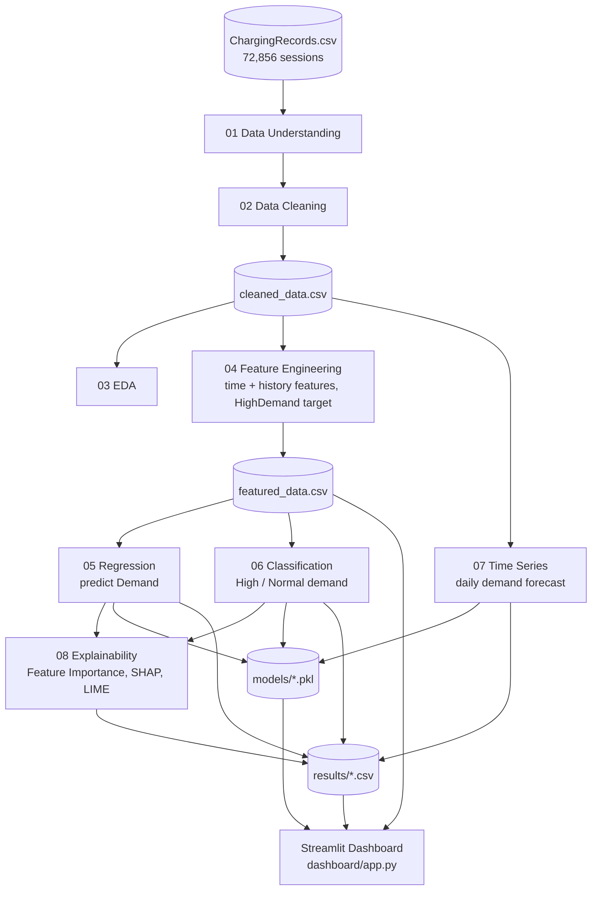

# EV Charging Demand Prediction and Usage Pattern Analysis

(Domain: Electric Vehicles and Sustainable Transportation).

An end-to-end machine learning project that analyzes EV charging station usage and predicts charging demand. It covers data cleaning, EDA, feature engineering, regression, classification, time series forecasting, model explainability (Feature Importance, SHAP, LIME) and an interactive Streamlit dashboard.

---

## Table of Contents

1. [Problem Statement](#1-problem-statement)
2. [Business Use Cases](#2-business-use-cases)
3. [Dataset](#3-dataset)
4. [Project Structure](#4-project-structure)
5. [Architecture & Workflow](#5-architecture--workflow)
6. [Step-by-Step Methodology](#6-step-by-step-methodology)
7. [Results](#7-results)
8. [Key Findings](#8-key-findings)
9. [Streamlit Dashboard](#9-streamlit-dashboard)
10. [Setup and Installation](#10-setup-and-installation)
11. [How to Run](#11-how-to-run)
12. [Saved Files](#12-saved-files)
13. [Limitations](#13-limitations)
14. [Future Improvements](#14-future-improvements)
15. [Tech Stack](#15-tech-stack)
16. [Author](#16-author)
17. [License](#17-license)

---

## 1. Problem Statement

Develop a machine learning system to analyze EV charging station usage patterns and predict charging demand based on charger type, location, charging company, time of charging and historical usage behavior.

The project has three machine learning problems:

| # | Problem | Type | Target |
|---|---|---|---|
| 1 | Charging Demand Prediction | Regression | `Demand` |
| 2 | High-Demand Session Prediction | Classification | `HighDemand` (Demand >= median) |
| 3 | Future Charging Demand Forecasting | Time Series | Daily total `Demand` |

The final output is a Streamlit dashboard that combines the analysis, predictions, forecasts and model explanations.

## 2. Business Use Cases

- **Demand forecasting:** anticipate busy and low-demand periods.
- **Station planning:** find locations and time periods with consistently high demand.
- **Capacity planning:** plan charger availability based on expected demand.
- **Peak demand management:** identify high-demand periods and reduce congestion.
- **Charger utilization analysis:** compare chargers, locations and companies, and find underused infrastructure.
- **Operational optimization:** improve staffing and maintenance scheduling.
- **Customer experience:** reduce waiting times during peak periods.
- **Long-term planning:** estimate future demand for infrastructure investment.

## 3. Dataset

- **File:** `ChargingRecords.csv`
- **Source:** publicly available EV charging transaction dataset
- **Size:** 72,856 charging sessions, 13 columns
- **Period:** 30 Sep 2021 to 30 Sep 2022 (366 days)

### Original columns

| Column | Description |
|---|---|
| `UserID` | Identifier of the user who charged |
| `ChargerID` | Identifier of the charger used |
| `ChargerCompany` | Company operating the charger (coded as a number, treated as a category) |
| `Location` | Type of place where the charger is installed (for example resort, camping, public area) |
| `ChargerType` | Type of charger (coded as a number, treated as a category) |
| `StartDay`, `StartTime` | Date and time charging started |
| `EndDay`, `EndTime` | Date and time charging ended |
| `StartDatetime`, `EndDatetime` | Start and end combined into one timestamp |
| `Duration` | Length of the charging session |
| `Demand` | Charging demand of the session (regression target) |

### Engineered columns

| Column | Description |
|---|---|
| `Hour`, `Day`, `Month`, `DayOfWeek` | Parts of the start time (`DayOfWeek`: 0 = Monday) |
| `IsWeekend` | 1 if the session started on Saturday or Sunday |
| `TimeOfDay` | Morning (5-12), Afternoon (12-17), Evening (17-21), Night (21-5) |
| `User_PrevSessions` | Number of earlier sessions by the same user |
| `User_AvgPastDemand` | The user's average demand over earlier sessions only |
| `Charger_PrevSessions` | Number of earlier sessions on the same charger |
| `Charger_AvgPastDemand` | The charger's average demand over earlier sessions only |
| `IsNewUser` | 1 if this is the user's first session |
| `HighDemand` | 1 if `Demand` >= median demand (14.1), else 0 (classification target) |

## 4. Project Structure

```
EV_Charging_Demand_Analysis/
├── data/
│   ├── raw/
│   │   └── ChargingRecords.csv
│   └── processed/
│       ├── cleaned_data.csv
│       └── featured_data.csv
├── notebooks/
│   ├── 01_data_understanding.ipynb
│   ├── 02_data_cleaning.ipynb
│   ├── 03_eda.ipynb
│   ├── 04_feature_engineering.ipynb
│   ├── 05_regression.ipynb
│   ├── 06_classification.ipynb
│   ├── 07_time_series.ipynb
│   └── 08_explainability.ipynb
├── models/
│   ├── best_regression_model.pkl
│   ├── best_classification_model.pkl
│   ├── ses_model.pkl
│   ├── holt_winters_model.pkl
│   └── moving_average_config.json
├── results/
│   ├── regression_results.csv
│   ├── classification_results.csv
│   ├── timeseries_results.csv
│   ├── reg_feature_importance.csv
│   ├── clf_feature_importance.csv
│   ├── shap_summary.png
│   ├── shap_bar.png
│   ├── lime_example.csv
│   ├── lime_session.csv
│   └── lime_example.html
├── dashboard/
│   └── app.py
├── requirements.txt
├── .gitignore
├── LICENSE
└── README.md
```

## 5.  Architecture & Workflow

### Workflow

```
Data Understanding -> Data Cleaning -> EDA -> Feature Engineering
-> Regression -> Classification -> Time Series -> Explainability -> Streamlit Dashboard
```

### Architecture



| Layer | Components | Output |
|---|---|---|
| **Data** | Raw CSV, cleaning, feature engineering | `cleaned_data.csv`, `featured_data.csv` |
| **Modeling** | Regression, Classification, Time Series | `models/*.pkl`, metric tables |
| **Explainability** | Feature Importance, SHAP, LIME | Importance CSVs, SHAP images, LIME output |
| **Application** | Streamlit dashboard | Interactive pages for analysis, prediction and forecasting |

## 6. Step-by-Step Methodology

### 6.1 Data Understanding (`01_data_understanding.ipynb`)
- Loaded the CSV and checked shape, columns, data types, summary statistics and unique values.
- Reviewed the first rows to understand what one record represents (one charging session).

### 6.2 Data Cleaning (`02_data_cleaning.ipynb`)
- Converted `StartDatetime`, `EndDatetime`, `StartDay`, `EndDay` to datetime.
- Converted `UserID`, `ChargerID`, `ChargerCompany`, `ChargerType` to categories (they are identifiers, not quantities).
- Checked missing values and removed duplicate rows.
- Checked correctness: end time before start time, `Demand <= 0`, `Duration <= 0`, and whether `Duration` matches the timestamps.
- Detected outliers with the IQR method. Outliers were **kept** because large sessions are real charging events. Only impossible values are treated as errors.
- Saved `data/processed/cleaned_data.csv`.

### 6.3 Exploratory Data Analysis (`03_eda.ipynb`)
- Univariate: histograms, box plots and skewness of `Demand` and `Duration`.
- Categorical: counts by charger type, company and location.
- Bivariate: average demand by charger type, company, location, hour, day of week and month.
- Correlation heatmap of numeric columns.
- Daily demand trend over the full period.

### 6.4 Feature Engineering (`04_feature_engineering.ipynb`)
- Time features: hour, day, month, day of week, weekend flag, time of day.
- History features: user and charger previous session count and past average demand.
- **Leakage control:** history features use `shift(1)` before the expanding mean, so a session's own `Demand` is never used in its own features. First-time users and chargers get 0.
- Classification target: `HighDemand = 1` if `Demand >= median(Demand)`.
- Class balance check: about 50.04% High and 49.96% Normal, so the classes are balanced.
- Saved `data/processed/featured_data.csv`.

### 6.5 Regression (`05_regression.ipynb`)
- **Features:** `ChargerCompany`, `ChargerType`, `Location`, `TimeOfDay` (one-hot encoded) and `Hour`, `Day`, `Month`, `DayOfWeek`, `IsWeekend`, history features, `IsNewUser` (standardized).
- **Not used as inputs:** `Duration`, `EndDatetime`, `EndDay`, `EndTime` (only known after charging ends) and `UserID`, `ChargerID` (too many unique values, covered by history features).
- **Split:** time-based. First 80% of sessions train, last 20% test. This avoids using future data to predict the past.
- **Models:** Linear Regression, Decision Tree, Random Forest, Gradient Boosting, XGBoost, LightGBM.
- **Metrics:** MAE, MSE, RMSE, R².
- Saved the best model as `models/best_regression_model.pkl`.

### 6.6 Classification (`06_classification.ipynb`)
- Same features and the same time-based split as regression.
- **Models:** Logistic Regression, Decision Tree, Random Forest, KNN, SVM, XGBoost, LightGBM. KNN and SVM were trained on a 15,000-row sample of the training data for speed.
- **Metrics:** Accuracy, Precision, Recall, F1-score, ROC-AUC.
- **Class imbalance:** checked first. Because the threshold is the median, the classes are about 50/50, so Random Oversampling, SMOTE and ADASYN were not required.
- Saved the best model (by ROC-AUC) as `models/best_classification_model.pkl`.

### 6.7 Time Series (`07_time_series.ipynb`)
- Aggregated demand per day (366 daily points).
- Decomposed into trend, weekly seasonality (period 7) and noise.
- Tested stationarity with the Augmented Dickey-Fuller (ADF) test, before and after differencing.
- Split by time: last 20% of days as the test period.
- **Models:** Moving Average (3, 7, 14 days), Simple Exponential Smoothing, Holt-Winters (additive trend and weekly seasonality).
- **Metrics:** MAE and RMSE.
- Identified increasing and decreasing months using month-on-month change.

### 6.8 Explainability (`08_explainability.ipynb`)
- **Feature importance** from the LightGBM and Random Forest models.
- **SHAP** (TreeExplainer on a 2,000-session test sample) for the direction and size of each feature's impact.
- **LIME** to explain one single prediction.

### 6.9 Dashboard (`dashboard/app.py`)
- Interactive Streamlit app that brings all the results together (see section 9).

## 7. Results

### Regression (test set, last 20% of sessions)

| Model | MAE | MSE | RMSE | R² |
|---|---|---|---|---|
| **LightGBM** | **8.2082** | **125.9225** | **11.2215** | **0.3496** |
| Random Forest | 8.4400 | 130.1697 | 11.4092 | 0.3277 |
| XGBoost | 8.2964 | 130.3838 | 11.4186 | 0.3266 |
| Linear Regression | 8.5510 | 133.6735 | 11.5617 | 0.3096 |
| Gradient Boosting | 9.2284 | 145.6440 | 12.0683 | 0.2478 |
| Decision Tree | 8.9138 | 155.3163 | 12.4626 | 0.1978 |

### Classification (test set, last 20% of sessions)

| Model | Accuracy | Precision | Recall | F1 | ROC-AUC |
|---|---|---|---|---|---|
| **Random Forest** | 0.7285 | 0.6973 | 0.7876 | 0.7397 | **0.8091** |
| LightGBM | 0.7302 | 0.6998 | 0.7868 | 0.7408 | 0.8070 |
| XGBoost | 0.7240 | 0.7045 | 0.7522 | 0.7276 | 0.8057 |
| Logistic Regression | 0.7114 | 0.7018 | 0.7145 | 0.7081 | 0.7888 |
| SVM | 0.7127 | 0.6780 | 0.7878 | 0.7288 | 0.7821 |
| Decision Tree | 0.7001 | 0.6899 | 0.7047 | 0.6972 | 0.7801 |
| KNN | 0.6941 | 0.6733 | 0.7298 | 0.7004 | 0.7623 |

Random Forest has the best ROC-AUC. LightGBM is slightly ahead on Accuracy and F1. The top models are very close.

### Time series (daily demand, last 20% of days as test)

| Model | MAE | RMSE |
|---|---|---|
| **Moving Average (7 days)** | 498.87 | **690.70** |
| Moving Average (14 days) | **495.61** | 701.01 |
| Moving Average (3 days) | 529.56 | 720.15 |
| Simple Exponential Smoothing | 586.79 | 808.08 |
| Holt-Winters | 813.22 | 1050.97 |

Moving Average is one-step-ahead (each day is predicted from the previous days). Simple Exponential Smoothing and Holt-Winters forecast the whole test period at once, which is harder, so the comparison favors Moving Average.

## 8. Key Findings

**What drives demand**
- The **past behavior of the user and the charger** (`User_AvgPastDemand`, `Charger_AvgPastDemand`) is the strongest predictor in both regression and classification.
- **Hour of day** is next, then the **number of past sessions** of the user and the charger.
- **Night** sessions push predicted demand up.
- Location, charger company, charger type, month and day of week have a small effect.
- Regression and classification agree on the same top factors, which makes the result more trustworthy.

**Feature importance vs SHAP**
- LightGBM's built-in importance ranks `Charger_AvgPastDemand` first, while SHAP ranks `User_AvgPastDemand` first. Built-in importance counts how often a feature is used in splits. SHAP measures the real impact on predictions, so SHAP is used as the main result.

**Time series**
- Daily demand grows from about 2,000 (Oct 2021) to about 4,500-5,000 (Jul-Aug 2022), with the peak month in Aug 2022 (143,041 total demand).
- There is a clear **weekly seasonality** (swing of about 250 around the trend).
- The series is **not stationary** (ADF p-value 0.34) and becomes stationary after differencing (p about 0).
- Large increases: Jan 2022 (+28.8%) and Jul 2022 (+18.8%).
- Decreases: Feb 2022 (-5.9%) and Sep 2022 (-22.3%). A sharp one-day drop around 5 Sep 2022 (to about 700) looks like an outage or missing-data day.
- The first month (Sep 2021, one partial day) and the last month may be partial, so their percentage changes should be ignored.

**Model quality**
- Regression R² is about 0.35: the features explain roughly a third of the variation in demand. The rest is individual behavior that the dataset does not contain.
- Classification reaches about 73% accuracy and 0.81 ROC-AUC.

## 9. Streamlit Dashboard

Run the app and use the **sidebar**: filters on top (location, charger type, company, date range) and a **Navigation** menu below them.

| Page | What it shows |
|---|---|
| **Overview** | KPIs, daily and monthly demand, demand distribution, day x hour heatmap, sessions by hour, time of day, location share, charger type and company, top 10 chargers. Each chart has a short explanation. |
| **Data Explore** | Data dictionary, data types, missing values, summary statistics, distributions, outliers, categorical explorer, correlation matrix, data preview and download. |
| **Regression** | Task explanation, model comparison, actual vs predicted, error distribution, important factors (feature importance, SHAP, LIME) and a **Predict demand** form with gauge, comparison chart and 24-hour curve. |
| **Classification** | Task explanation, class balance check, model comparison, confusion matrix with adjustable threshold, ROC curve, important factors and a **Classify session** form with gauge, probability chart and 24-hour curve. |
| **Time Series** | Daily series, trend / seasonality / noise, ADF test, Moving Average and Exponential Smoothing with MAE and RMSE, increasing and decreasing periods, and a future forecast. |
| **Models & Explainability** | Best model per task, full model comparison, feature importance, SHAP and LIME explanations, key findings and limits. |

Sidebar filters apply to Overview and Time Series. Regression and Classification use the fixed 80/20 time-based test set.

## 10. Setup and Installation

**Requirements:** Python 3.10 or newer.

```bash
# 1. Clone the repository
git clone https://github.com/ssrikanthssk/EV_Charging_Demand_Analysis
cd EV_Charging_Demand_Analysis

# 2. (Recommended) create a virtual environment
python -m venv venv
venv\Scripts\activate          # Windows
# source venv/bin/activate     # macOS / Linux

# 3. Install dependencies
pip install -r requirements.txt
```

Place `ChargingRecords.csv` in `data/raw/` if it is not already there.

## 11. How to Run

### Option A: run only the dashboard (uses the saved files)
```bash
streamlit run dashboard/app.py
```
Open the link shown in the terminal (usually http://localhost:8501).

The dashboard needs these files, which are included in the repository:
`data/processed/featured_data.csv`, `models/best_regression_model.pkl`,
`models/best_classification_model.pkl` and the files in `results/`.

### Option B: reproduce the whole analysis
Run the notebooks in order. Each notebook saves the output that the next one loads.

| Order | Notebook | Output |
|---|---|---|
| 1 | `01_data_understanding.ipynb` | (exploration only) |
| 2 | `02_data_cleaning.ipynb` | `data/processed/cleaned_data.csv` |
| 3 | `03_eda.ipynb` | (exploration only) |
| 4 | `04_feature_engineering.ipynb` | `data/processed/featured_data.csv` |
| 5 | `05_regression.ipynb` | `results/regression_results.csv`, `models/best_regression_model.pkl` |
| 6 | `06_classification.ipynb` | `results/classification_results.csv`, `models/best_classification_model.pkl` |
| 7 | `07_time_series.ipynb` | `results/timeseries_results.csv`, time series models |
| 8 | `08_explainability.ipynb` | feature importance CSVs, SHAP images, LIME files |

Then start the dashboard with Option A.

## 12. Saved Files

| Folder | Content |
|---|---|
| `data/processed/` | Cleaned and feature-engineered datasets |
| `models/` | Pickled best models (joblib) |
| `results/` | Metric tables, feature importance, SHAP images, LIME output |

Models are saved as full scikit-learn pipelines (preprocessing + model), so raw feature columns can be passed directly to `predict`:

```python
import joblib
model = joblib.load("models/best_regression_model.pkl")
model.predict(X_new)   # X_new has the same 14 input columns used in training
```

## 13. Limitations

- One `UserID` (likely a guest or default ID) holds about 43% of sessions (31,553 of 72,856), so its history features act as a group average rather than one person's behavior.
- Regression R² is moderate (about 0.35) because individual charging needs (battery size, trip purpose) are not in the data.
- The first and last days and months are partial, which affects edge values in the time series.
- Time series models are simple (Moving Average, Exponential Smoothing). Holt-Winters drifts upward at the end of the test period because the trend flattened in Sep 2022.
- The classification threshold (median) splits the data 50/50 by design, so imbalance handling (SMOTE, ADASYN) was checked but not needed.
- KNN and SVM were trained on a sample of the training data for speed.

## 14. Future Improvements

- Add weather, holidays and local events as features.
- Try ARIMA / SARIMA, Prophet or LSTM for forecasting.
- Hyperparameter tuning (Optuna or RandomizedSearchCV) for the boosting models.
- Hourly forecasting per location.
- Deploy the dashboard on Streamlit Community Cloud.

## 15. Tech Stack

Python, Pandas, NumPy, Matplotlib, Seaborn, Scikit-learn, XGBoost, LightGBM, Imbalanced-learn, Statsmodels, SHAP, LIME, Plotly, Streamlit, Joblib, Jupyter, Git / GitHub.

## 16. Author

**Srikanth S**
EV Charging Demand Prediction and Usage Pattern Analysis
GitHub: [ssrikanthssk](https://github.com/ssrikanthssk)

## 17. 📄 License

Distributed under the MIT License. See `LICENSE` for more information.

---

